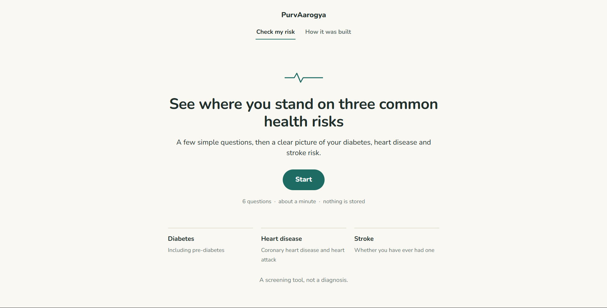
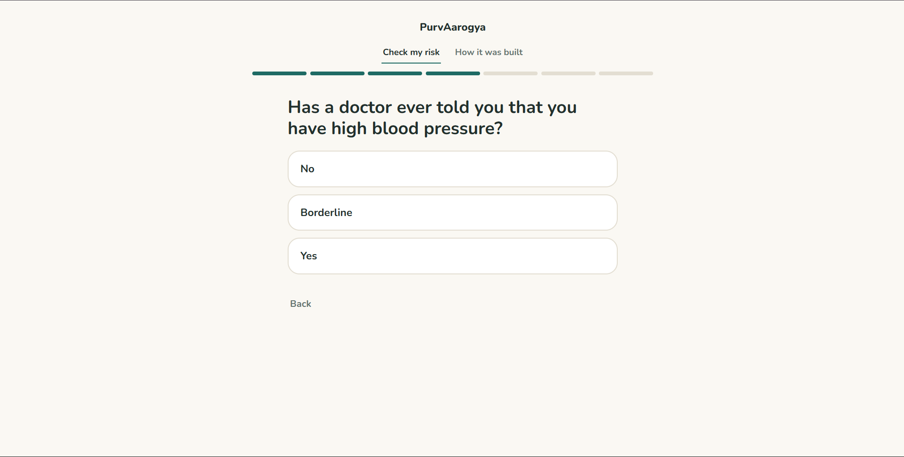
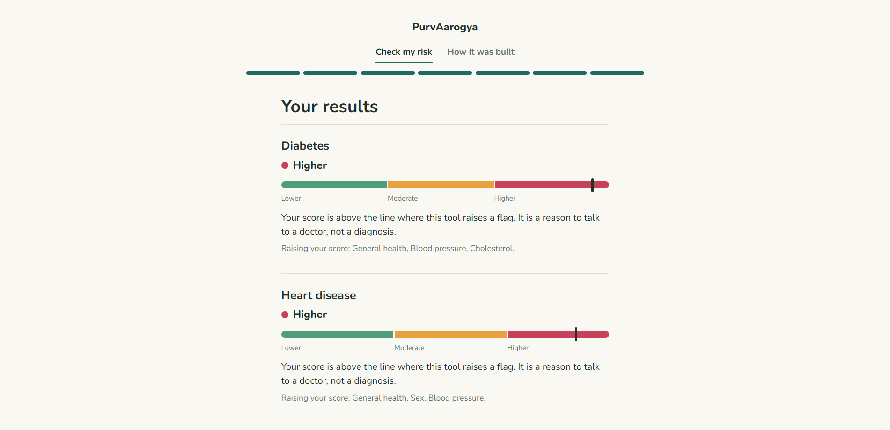
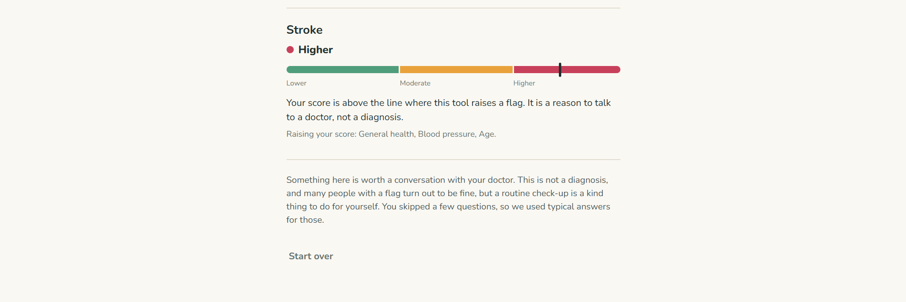
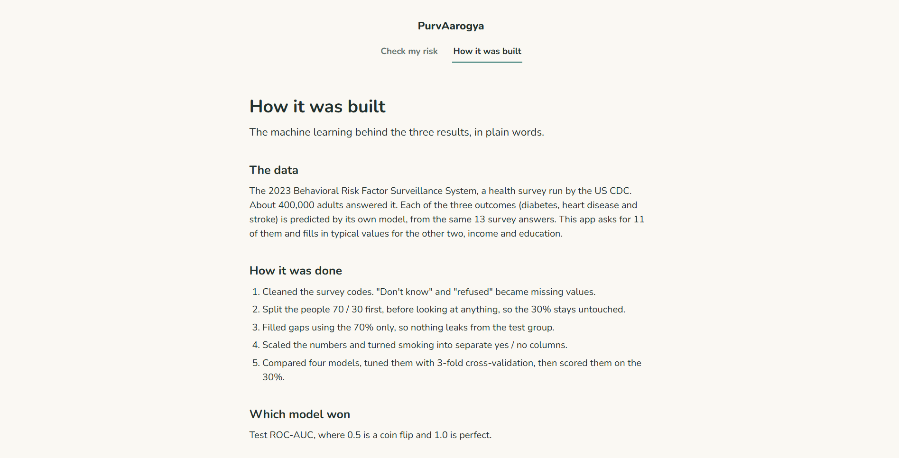

# purvArogya

A multi-risk health screening system: Diabetes, Cardiovascular Disease and Stroke, predicted independently from one population survey.

## Overview

Many health machine learning projects either predict a single disease or merge unrelated datasets (for example Pima Diabetes with Cleveland Heart Disease) to build an "overall health score". That merged score is not scientifically valid because the samples come from different populations.

purvArogya takes a different route: **one population cohort, one shared feature vector, three independent binary classifiers.**

This is a preventive **screening tool, not a diagnostic tool.** It shows where a person's risk score sits relative to survey respondents, helping people decide whether to talk to a doctor. It does not provide medical diagnoses or promises of health.

## Live Demo

Live application: <https://purvarogya.onrender.com>

The web app is hosted on Render's free tier. The free plan sleeps after 15 minutes of inactivity, so the first load can take about a minute to wake up.

### Screenshots

#### Welcome screen


#### A question


#### Two example results




#### The "How it was built" page


The numbers on the "How it was built" page live in `web/about.js` and were copied from the notebook ([`notebooks/purvarogya.ipynb`](notebooks/purvarogya.ipynb)), so they must be updated together if the models are ever retrained.

## Results

Final model per disease: Logistic Regression (C = 0.01, class_weight balanced), scored once on the held-out 30% test set (119,244 people).

| Target | ROC-AUC | Recall | Precision | F1 |
|---|---|---|---|---|
| Diabetes | 0.811 | 0.763 | 0.337 | 0.468 |
| Cardiovascular disease | 0.834 | 0.793 | 0.207 | 0.328 |
| Stroke | 0.802 | 0.772 | 0.097 | 0.172 |

Random Forest and XGBoost scored within 0.007 ROC-AUC of this, showing that the 13 survey features, not the algorithm, are the limit. I kept Logistic Regression because it is simple and its linear coefficients can be explained. Its raw scores are **not real probabilities** (balanced class weights inflate them), so the app presents a risk flag, risk level, and survey percentile rather than a percentage chance.

Every modelling decision and its reason is logged in [`docs/DECISIONS.md`](docs/DECISIONS.md). The full analysis, baseline comparisons, tuning, and ablation studies are in [`notebooks/purvarogya.ipynb`](notebooks/purvarogya.ipynb).

## Data

- **Source:** CDC BRFSS Survey 2023 (Behavioral Risk Factor Surveillance System), downloaded from Kaggle: [`isuruprabath/brfss-2023-csv-dataset`](https://www.kaggle.com/datasets/isuruprabath/brfss-2023-csv-dataset).
- **License:** CC0-1.0.
- **Size:** 433,323 rows x 350 columns.
- **Cleaned subset:** 397,478 rows, 13 features, 3 binary targets.

| Target | Positive cases (approx.) |
|---|---|
| Diabetes (incl. pre-diabetes) | ~16% |
| Cardiovascular disease | ~8.3% |
| Stroke | ~4.0% |

The raw dataset (`BRFSS2023.csv`) is large (~55 MB compressed) and is **not included in this repository**. The training workflow was run in Google Colab using [`notebooks/purvarogya.ipynb`](notebooks/purvarogya.ipynb), which cleans the data, fits the imputation on the training split, tunes models, and exports the serialized pipelines saved in [`models/`](models/).

To download the raw data with the Kaggle CLI:
```bash
kaggle datasets download -d isuruprabath/brfss-2023-csv-dataset
```

## Project Structure

```
purvArogya/
├── api/                    # FastAPI backend
│   ├── __init__.py
│   ├── main.py             # endpoints (/health, /predict, /) and static file serving
│   └── schemas.py          # Pydantic input validation models
├── docs/                   # project documentation and images
│   ├── DECISIONS.md        # log of every modelling and design choice with rationale
│   └── images/             # UI screenshots used in this README
├── models/                 # trained model pipelines and score percentiles
│   ├── cvd_model.joblib
│   ├── diabetes_model.joblib
│   ├── feature_names.joblib
│   ├── score_percentiles.joblib
│   └── stroke_model.joblib
├── notebooks/              # modelling notebook
│   └── purvarogya.ipynb    # full pipeline from raw data to saved models
├── purvarogya/             # core Python package
│   ├── __init__.py
│   ├── config.py           # survey codes, targets, features, and cleaning rules
│   ├── inputs.py           # converts user inputs into the row format models expect
│   ├── preprocessing.py    # survey code cleaning and train-only imputer
│   └── scoring.py          # scoring, percentiles, risk levels, and score drivers
├── tests/                  # automated pytest tests
│   ├── test_api.py         # tests for FastAPI endpoints and static routes
│   ├── test_inputs.py      # tests for input mapping and typical value defaults
│   ├── test_preprocessing.py # tests for data cleaning and leakage prevention
│   ├── test_schemas.py     # tests for Pydantic validation rules
│   └── test_scoring.py     # tests for scoring and risk categorization
├── web/                    # frontend files served by FastAPI
│   ├── about.js            # static model metrics for the about page
│   ├── app.js              # quiz navigation, input validation, and results rendering
│   ├── index.html          # screening interface and "How it was built" tab
│   └── style.css           # responsive styles
├── .gitignore              # git ignore rules
├── .python-version         # Python version (3.13)
├── LICENSE                 # MIT license
├── README.md               # project overview and instructions
├── requirements.txt        # pinned dependencies for running the app
└── requirements-dev.txt    # dependencies for development and testing
```

## Run Locally

Tested with Python 3.13 (see [`.python-version`](.python-version)).

1. Clone the repository:
```bash
git clone https://github.com/MaitriSagar/purvArogya.git
cd purvArogya
```

2. Create and activate a virtual environment:

On Windows:
```powershell
python -m venv .venv
.\.venv\Scripts\activate
```

On macOS / Linux:
```bash
python3 -m venv .venv
source .venv/bin/activate
```

3. Install runtime dependencies:
```bash
pip install -r requirements.txt
```

4. Run the web server:
```bash
uvicorn api.main:app --reload
```

5. Open the app:
- Frontend: [http://127.0.0.1:8000](http://127.0.0.1:8000)
- Swagger documentation: [http://127.0.0.1:8000/docs](http://127.0.0.1:8000/docs)

## Run Tests

To install test dependencies and run the pytest test suite:

```bash
pip install -r requirements-dev.txt
python -m pytest
```

## Deployment

The app is deployed as a Web Service on [Render](https://render.com).

- **Environment:** Python (see [`.python-version`](.python-version))
- **Build command:** `pip install -r requirements.txt`
- **Start command:** `uvicorn api.main:app --host 0.0.0.0 --port $PORT`

## Limitations

- **Self-reported US survey:** The models were trained on US adults from the CDC BRFSS survey. Responses are self-reported and may not generalize as well to other populations.
- **Cross-sectional data:** The survey records a single point in time, identifying statistical correlations rather than causal effects.
- **Only 13 features:** The screening relies on 13 survey questions without clinical lab values (such as blood tests or lipid panels) or family medical history.
- **Scores are not probabilities:** Because balanced class weights were used during training to handle class imbalance, model scores are inflated and cannot be treated as real probabilities. The app presents relative survey percentiles and risk categories.
- **Low precision:** For rare conditions like stroke (~4% prevalence), precision is around 0.097, meaning many flags are false alarms; recall was prioritized so fewer cases are missed.
- **Not a diagnosis:** This tool is intended for preventive risk screening only. It does not replace clinical judgment or a visit to a doctor.
